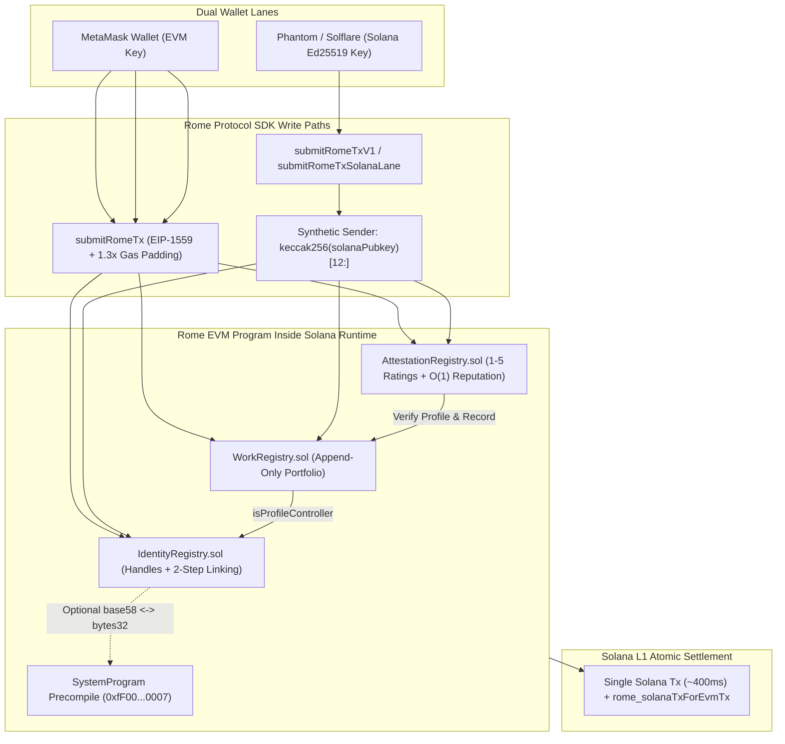
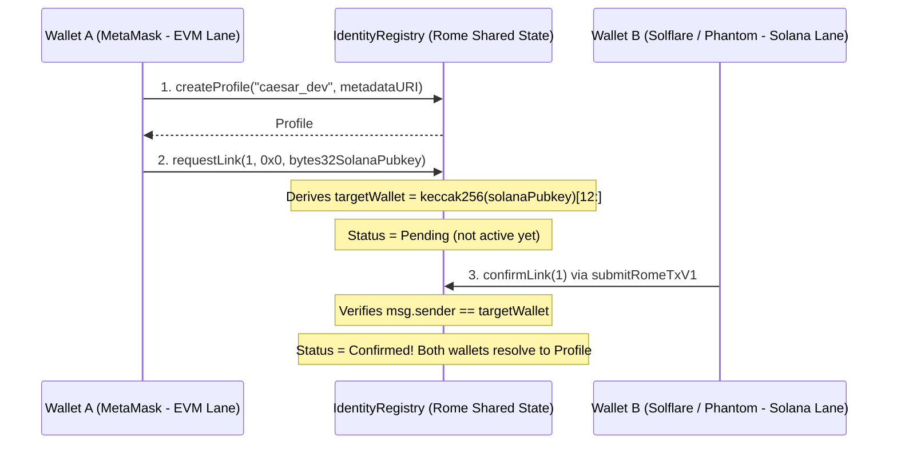

# RomeID — Unified Dual-Lane Identity, Portfolio & Portable Reputation on Rome Protocol

> **Built for Rome Arena** · Combines and extends the official Arena catalogue ideas **Identity Manager** and **HIREhub** over Rome Protocol's shared EVM-in-Solana state.

**RomeID** binds an Ethereum wallet (**MetaMask**) and a Solana wallet (**Phantom / Solflare / Backpack**) to **one shared on-chain profile** executing natively inside Solana's runtime on Rome EVM. Any confirmed wallet on either lane can manage the profile, publish append-only work records, and receive cryptographically signed employer attestations that compute an O(1) portable **Reputation Score (0–1000)**.

---

## 1. Architecture & Dual-Lane Flow



### Trustless 2-Step Wallet Linking



---

## 2. Verified Solana-Lane Wallet Mapping & Assumptions

Verified directly against `@rome-protocol/sdk` (`v0.4.0`), `@rome-protocol/cli` (`v0.12.0` `AGENTS.md` v3.6), and `@rome-protocol/rome-solidity`:

1. **How `msg.sender` appears to Solidity from a Solana wallet:**
   - A Solana user signs with their native 32-byte Ed25519 Solana keypair (no EVM private key needed).
   - Rome's on-chain program (`do_tx_unsigned::derive_sender`) deterministically derives the caller's 20-byte **Synthetic EVM Address**:
     $$\text{syntheticAddress}(\text{pubkey}) = \text{keccak256}(\text{pubkey}_{32\text{ bytes}})[12:]$$
   - Inside Solidity, `IdentityRegistry.deriveSyntheticAddress(bytes32 solanaPubkey)` computes `address(uint160(uint256(keccak256(abi.encodePacked(solanaPubkey)))))`, verified byte-for-byte in unit tests against `syntheticAddress(PublicKey)` from `@rome-protocol/sdk` across random Solana keypairs.
2. **Future-proof linking design:**
   - `requestLink(uint256 profileId, address otherWalletIdentifier, bytes32 solanaPubkey)` auto-derives `targetWallet` when `otherWalletIdentifier == address(0)` and `solanaPubkey != bytes32(0)`, **and** also accepts an explicit `otherWalletIdentifier` address so the two-step `requestLink -> confirmLink` handshake works with *any* `msg.sender` mapping.
   - A link is **never** active until Wallet B signs `confirmLink(profileId)` from its own lane (`msg.sender == targetWallet`). Either side (`profileController` or `linkedWallet`) can call `unlinkWallet(profileId, wallet)` at any time.
3. **Rome `SystemProgram` Precompile (`0xfF00000000000000000000000000000000000007`):**
   - `IdentityRegistry` exposes optional `solanaPubkeyToBase58(bytes32)` and `base58ToSolanaPubkey(string)` helpers calling `IRomeSystemProgram` via `staticcall` when executing on Rome EVM (reverting cleanly with `SystemPrecompileUnavailable` on local non-Rome EVMs).
4. **Devnet Wallet Compatibility (Solflare vs Phantom):**
   - Per Rome's official `AGENTS.md` (v3.6), on Solana devnet **Solflare** signs Solana v1 transactions (`submitRomeTxV1`) natively, whereas **Phantom** does not yet sign v1 wire transactions on devnet.
   - Our frontend (`frontend/src/lib/romeLane.ts`) uses `submitRomeTxV1` (with automatic one-time `isSyntheticProvisioned` + `buildCreatePdaCall` activation) when supported, and seamlessly falls back to `@rome-protocol/sdk`'s `submitRomeTxSolanaLane` (`DoTxUnsigned` legacy transaction) so **both Solflare and Phantom** work out of the box.

---

## 3. Portable Reputation Score Formula (0–1000)

Implemented in `AttestationRegistry.getReputation(uint256 profileId)` in $O(1)$ gas:

- If `activeAttestations == 0`, returns `score = 0`.
- Otherwise:
  1. **Quality Component (max 700 pts — 70% weight):**
     $$\text{qualityPts} = \left\lfloor \frac{\text{ratingSum} \times 140}{\text{activeAttestations}} \right\rfloor$$
  2. **Volume Component (max 200 pts — 20% weight):**
     $$\text{volumePts} = \min(\text{activeAttestations} \times 20,\ 200)$$
  3. **Attester Diversity Bonus (max 100 pts — 10% weight):**
     $$\text{diversityPts} = \min(\text{distinctAttesters} \times 20,\ 100)$$
  4. **Total Score:** `score = qualityPts + volumePts + diversityPts` (bounded in `[180, 1000]`).
- **Anti-gaming invariant:** Profile controllers cannot self-attest (`SelfAttestationForbidden`). Revoking a work record blocks *new* attestations on that record, while existing employer attestations remain counted unless revoked by the original attester via `revokeAttestation()`.

---

## 4. Deployed Addresses (Hadrian Testnet — Chain ID `200010`)

> All chain facts (`chainId`, `rpcUrl`, `explorerUrl`, `romeEvmProgramId`, `nativeCurrency`) are resolved dynamically at runtime from `@rome-protocol/registry` — never hardcoded.

| Contract | Address | Deployment Tx |
|---|---|---|
| `IdentityRegistry` | `Populated in deployments/200010.json & .env on npm run deploy` | — |
| `WorkRegistry` | `Populated in deployments/200010.json & .env on npm run deploy` | — |
| `AttestationRegistry` | `Populated in deployments/200010.json & .env on npm run deploy` | — |

---

## 5. Project Structure

```text
romeid/
├── .mcp.json                 # Rome MCP server config ({ "command": "rome", "args": ["mcp"] })
├── .env.example              # Environment template (no secrets committed)
├── contracts/                # Solidity ^0.8.28 + Hardhat tests & coverage + foundry.toml
│   ├── src/
│   │   ├── IdentityRegistry.sol
│   │   ├── WorkRegistry.sol
│   │   ├── AttestationRegistry.sol
│   │   └── interfaces/
│   └── test/RomeID.test.ts   # >95% line coverage + @rome-protocol/sdk cross-verification
├── scripts/
│   ├── deploy.ts             # Deploys all 3 registries + queries rome_solanaTxForEvmTx
│   ├── verify.ts             # Verifies live bytecode, state reads & Solana settlement
│   └── seed.ts               # Headless dual-lane E2E flow (EVM + Solana lanes)
└── frontend/                 # Next.js 14 (App Router) + TypeScript + Tailwind CSS
    └── src/app/
        ├── page.tsx          # 1. Landing Page
        ├── dashboard/        # 2. Profile, Linked Wallets & Reputation Dashboard
        ├── link/             # 3. Guided 2-Step Link Wallet Wizard
        ├── work/             # 4. Append-Only Work Records Manager
        ├── attest/           # 5. Public Shareable Employer Attestation Portal
        └── p/[handle]/       # 6. Public Read-Only Profile Page
```

---

## 6. Quickstart: Test, Fund, Deploy & Run

### A. Install & Run Smart Contract Tests + Coverage
```bash
cd contracts
npm install --legacy-peer-deps
npm run test
npm run coverage
```

### B. Fund Deployer Gas on Hadrian (`>= 0.5 USDC`, recommended `1 USDC`)
Gas on Rome Hadrian is **USDC** (bridged via CCTP — there is no Rome faucet):
```bash
# Check chain & wallet readiness
rome doctor hadrian

# Bridge 1 USDC from Sepolia (or Base Sepolia / Solana devnet) into Hadrian gas
export ROME_EVM_KEY="0xYOUR_PRIVATE_KEY"
rome fund hadrian --from sepolia --amount 1
```

### C. Deploy & Verify on Hadrian Testnet
```bash
cp .env.example .env
# Set PRIVATE_KEY=0x... (and optional ROME_SOLANA_KEY=[...] for headless dual-lane verify)
npm install --legacy-peer-deps
npm run deploy
npm run verify

# Optional CLI cross-checks:
rome tx hadrian <DEPLOY_TX_HASH>
rome verify hadrian --path solidity
```

### D. Run the Next.js Dual-Lane Frontend
```bash
cd frontend
npm install --legacy-peer-deps
npm run dev
# Open http://localhost:3000
```

---

## 7. Rome Arena Registration Steps

1. Deploy `IdentityRegistry`, `WorkRegistry`, and `AttestationRegistry` to **Hadrian Testnet** (`200010`) and confirm via `npm run verify` + `rome tx hadrian <hash>`.
2. Visit **Rome Arena** at https://arena.mainnet.romeprotocol.xyz/apps/new and sign in.
3. Register **RomeID**, select the **Builder** role, and link all 3 deployed contract addresses + your GitHub repository & live Vercel URL.
4. Apply for a Builder Grant once verified on Hadrian, then set `CHAIN_ID=7531` in `.env` to graduate seamlessly to **Rubicon Mainnet** (resolved automatically from `@rome-protocol/registry`) to climb tiers (*Legionary → Patrician → Pontifex Maximus*).

---

## 8. 5-Step Video Demo Script (2–3 Minutes)

1. **Dual-Lane Connect & Chain Grounding (0:00–0:30):** Open the Landing Page (`/`), highlight live Hadrian chain facts pulled from `@rome-protocol/registry`, and connect **MetaMask** (EVM lane) + **Solflare / Phantom** (Solana lane, showing the derived synthetic EVM address).
2. **Create RomeID Profile on EVM Lane (0:30–1:00):** Open `/dashboard`, mint `@caesar_dev` from MetaMask via `submitRomeTx`, and click the **Rome Explorer** + **Solana L1 Settlement** links in the confirmation banner.
3. **2-Step Trustless Wallet Link Across Lanes (1:00–1:45):** Go to `/link`, click **Step 1 (`requestLink`)** with MetaMask targeting the connected Solana wallet, then switch to the Solana wallet and sign **Step 2 (`confirmLink`)** from the Solana lane (`submitRomeTxV1`). Show both wallets marked `CONFIRMED`.
4. **Add Work Record from Solana Lane (1:45–2:15):** Keep the **Solana wallet** active (proving one shared profile across lanes!), open `/work`, publish a portfolio deliverable, and copy the shareable **Employer Attest Link** (`/attest?profileId=1&recordId=1`).
5. **Employer Attestation & Public Portable Reputation (2:15–2:45):** Open the shareable `/attest` link with a third employer wallet, submit a **5-star** attestation, then visit `/p/caesar_dev` (logged out / read-only) to showcase the unified EVM + Solana wallets, verified work record, employer review, and live **740 / 1000** Reputation Score.
